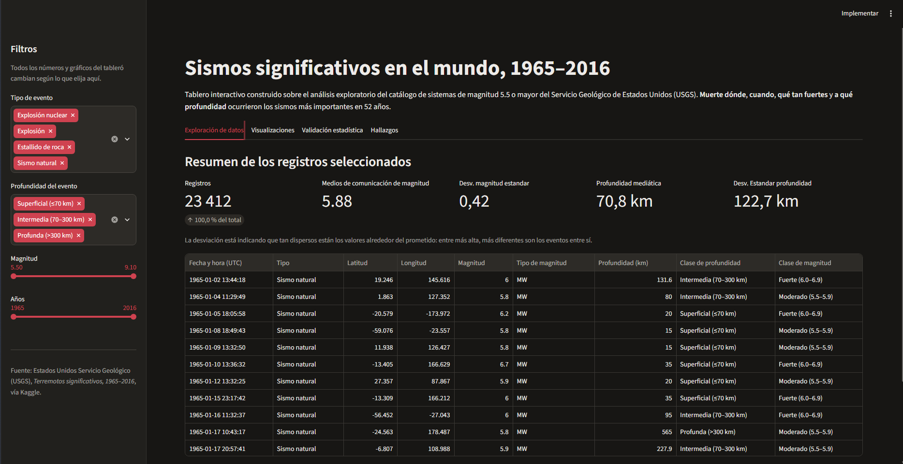

# Sismos significativos en el mundo, 1965–2016

[](https://sismos-hermes-reyes.streamlit.app)

## Descripción del proyecto

Este repositorio contiene un dashboard interactivo construido en Streamlit a partir del análisis exploratorio de datos (EDA) realizado en la Tarea 3 del curso Programación para el Análisis de Datos. El dashboard no es un análisis nuevo: presenta los mismos datos y conclusiones de la Tarea 3 de forma interactiva, pensado para que un directivo o profesional sin formación en estadística pueda explorar la información y entender los hallazgos.

Se usó el catálogo *Significant Earthquakes, 1965–2016* del Servicio Geológico de Estados Unidos (USGS), publicado en Kaggle. Reúne 23 412 eventos de magnitud 5.5 o mayor ocurridos en todo el mundo, con fecha, ubicación, magnitud, profundidad y tipo de evento (sismo natural, explosión nuclear, explosión o estallido de roca).

El dataset se escogió por su relación con la ingeniería y la gestión del riesgo: la magnitud y la profundidad de un sismo determinan cuánto se sacude el terreno y qué tanto daño puede sufrir la infraestructura. Además, al estar georreferenciado y cubrir 52 años, permite estudiar cómo se distribuyen los sismos en el espacio y en el tiempo.

## Dashboard publicado

El dashboard está disponible en: **https://sismos-hermes-reyes.streamlit.app**



El tablero tiene filtros por tipo de evento, clase de profundidad, magnitud y años, y cuatro secciones: exploración de datos, visualizaciones, validación estadística y hallazgos.

## Hallazgos principales

1. El 68.6 % de los sismos registrados son moderados (magnitud entre 5.5 y 5.9). Solo 40 eventos en 52 años alcanzaron magnitud 8 o más.
2. El 79.9 % de los sismos se originan a menos de 70 km de profundidad, que son los que más sacuden el terreno y las construcciones.
3. Los epicentros se concentran en el Cinturón de Fuego del Pacífico y en la franja que va del Mediterráneo a Indonesia, siguiendo los bordes de las placas tectónicas.
4. La profundidad de los sismos naturales (71.3 km en promedio) es muy distinta a la de las explosiones nucleares (0.3 km). La prueba t de Welch confirmó que la diferencia no se debe al azar (t = 85.62, p < 0.001).
5. El número de sismos registrados por año pasó de unos 240 en 1965 a entre 450 y 550 en los años recientes, lo que se explica sobre todo por la mejora de las redes de medición y no por un aumento de la actividad sísmica.

## Estructura del repositorio

| Archivo | Contenido |
|---|---|
| `app.py` | Código del dashboard en Streamlit |
| `database.csv` | Catálogo de sismos del USGS (2.3 MB) |
| `requirements.txt` | Librerías necesarias para ejecutar la app |
| `captura_dashboard.png` | Captura de pantalla del dashboard |
| `README.md` | Este documento |

## Instalación y ejecución local

1. Instalar Python 3.10 o superior desde [python.org](https://www.python.org/downloads/). En Windows, marcar la opción *Add Python to PATH* durante la instalación.
2. Descargar el repositorio con el botón verde **Code → Download ZIP** y descomprimirlo, o clonarlo con Git:
   ```
   git clone https://github.com/santiagobermudezu31-wq/sismos-dashboard.git
   cd sismos-dashboard
   ```
3. Instalar las librerías:
   ```
   python -m pip install -r requirements.txt
   ```
4. Ejecutar el dashboard:
   ```
   python -m streamlit run app.py
   ```
5. Abrir en el navegador la dirección http://localhost:8501 si no se abre de forma automática.

## Fuente de los datos

U.S. Geological Survey. (s. f.). *Significant Earthquakes, 1965–2016* [Conjunto de datos]. Kaggle. https://www.kaggle.com/datasets/usgs/earthquake-database

## Autor

- **Estudiante:** Hermes Santiago Reyes Bermúdez
- **Curso:** Programación para el Análisis de Datos (203008069A_2204), grupo 31
- **Universidad:** Universidad Nacional Abierta y a Distancia (UNAD)
- **Fecha:** noviembre de 2026
